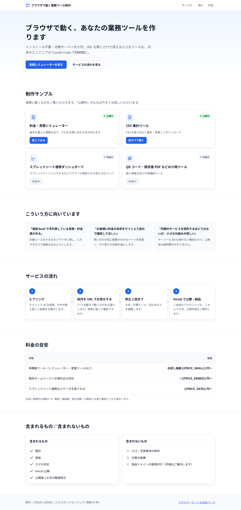
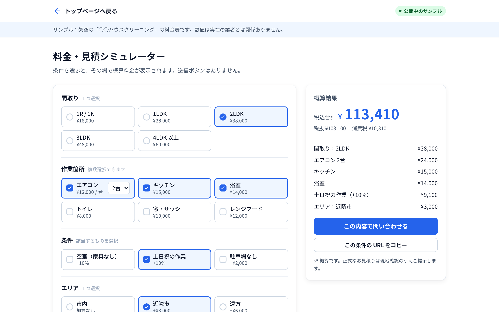

# ブラウザで動く業務ツール制作 — ショーケースサイト

リベシティ スキルマーケット出品用のサンプルサイトです。
純粋な HTML / CSS / JavaScript のみで、ビルド工程・サーバー・DB・API キーは使いません。

```
/
├── index.html               ← ショーケース（トップページ）
├── estimate/
│   └── index.html           ← 料金・見積シミュレーター（動作する実物）
├── og.html                  ← OG 画像生成用の 1200×630 ページ（リンクはしない・noindex）
├── og.png                   ← og.html を Playwright で撮影した画像（2400×1260 @2x）
├── screenshot-estimate.png  ← 出品ページ説明欄用（estimate/ を 1280×800 @2x で撮影）
├── screenshot-top.png       ← 出品ページ説明欄用（トップページを 1280 幅・全画面で撮影）
├── assets/
│   └── style.css            ← 共通スタイル（配色は :root の CSS 変数）
├── scripts/
│   └── shoot.mjs            ← 画像生成スクリプト
├── package.json             ← shoot / serve スクリプト用（デプロイには不要）
└── README.md
```

## スクリーンショット

### トップページ（ショーケース）



### 料金・見積シミュレーター

検算例（2LDK + エアコン 2 台 + キッチン + 浴室、土日祝、近隣市 → 税込 113,410 円）を選択した状態です。



### OG 画像（出品 TOP 画像 / SNS プレビュー）


## ローカルで確認する

```bash
npx serve .
```

`http://localhost:3000/` でトップ、`http://localhost:3000/estimate/` でシミュレーターが開きます。
（`file://` で直接開いても CSS は読めますが、`/og.png` などルート絶対パスの確認には静的サーバーが必要です。）

## Vercel へデプロイする

`vercel.json` は不要です。静的配信のデフォルト設定でそのまま動きます。

### A. GitHub 連携（推奨）

1. このフォルダを GitHub リポジトリに push する。
2. [vercel.com/new](https://vercel.com/new) でそのリポジトリを Import。
3. Framework Preset は **Other** のまま、Build Command / Output Directory は空欄で **Deploy**。
4. 以後は `main` に push するたびに自動デプロイされます。

### B. `vercel` CLI

```bash
npm i -g vercel
vercel login
vercel          # プレビュー
vercel --prod   # 本番
```

質問には「Framework: Other」「Build Command / Output Directory: 空欄」で答えます。

> `og:image` は仕様どおり `/og.png`（ルート相対）を指しています。
> 一部の SNS クローラーは絶対 URL しか読まないため、公開 URL が決まったら
> `index.html` / `estimate/index.html` の `og:image` / `twitter:image` を
> `https://<あなたのドメイン>/og.png` に書き換えることをおすすめします。

## `{{ }}` の置き換え箇所一覧

| プレースホルダ | ファイル | 内容 |
| --- | --- | --- |
| `{{PRICE_SMALL}}` | `index.html` | 単機能ツールのお試し価格（円） |
| `{{PRICE_EMBED}}` | `index.html` | 既存ホームページへの埋め込み対応の追加料金（円） |
| `{{PRICE_DATA}}` | `index.html` | スプレッドシート連携などデータを扱うものの価格（円） |
| `{{YOUR_NAME}}` | `index.html` | フッターの制作者名 |
| `{{SKILL_MARKET_URL}}` | `index.html` | スキルマーケットの出品ページ URL |
| `{{CONTACT_EMAIL}}` | `estimate/index.html`（`CONFIG.contactEmail`） | 「メールで送る」の宛先 |

一括で確認するには:

```bash
grep -rn "{{" index.html estimate/index.html
```

## 業種を変えるとき

触るのは **`estimate/index.html` の先頭にある `CONFIG` オブジェクトだけ** です。

```js
const CONFIG = {
  businessName: "○○ハウスクリーニング",   // 画面上部の注記に表示
  contactEmail: "{{CONTACT_EMAIL}}",
  taxRate: 0.10,
  layouts:   [ { id, label, price } ],                 // 単一選択の基本料金
  items:     [ { id, label, price, unit?, maxQty? } ], // 複数選択（maxQty があると数量セレクトが出る）
  modifiers: [ { id, label, rate? | add? } ],          // rate: 割合（基本料金+作業箇所に対して） / add: 固定加算
  areas:     [ { id, label, add } ],                   // 単一選択の固定加算
};
```

- `id` は URL クエリ（`?layout=2ldk&items=aircon:2,kitchen&mods=weekend&area=near`）にそのまま使われます。英数字で付けてください。
- フォームの生成・計算・URL 同期・問い合わせ文の生成はすべて `CONFIG` から自動で行われるため、HTML 側の修正は不要です。
- 「間取り」「作業箇所」などの見出し文言を変えたい場合は、同ファイルの `<legend>` を編集します。

### 計算ルール

1. 小計 = 間取り基本料金 + Σ(作業箇所 × 数量) + エリア加算 + 固定加算（`add`）
2. 割合条件（`rate`）は「間取り基本料金 + 作業箇所合計」に対してのみ適用（エリア加算・固定加算には掛けない）。複数選択時は加算的に適用。
3. 税抜合計 → 消費税（1 円未満切り捨て）→ 税込合計
4. 入力が変わるたびに即時再計算

検算例: 2LDK + エアコン 2 台 + キッチン + 浴室、土日祝、近隣市
→ 税抜 (38,000 + 24,000 + 15,000 + 14,000) × 1.10 + 3,000 = **103,100 円**、税込 **113,410 円**

## og.png / screenshot-estimate.png を再生成する

```bash
npm i -D playwright
npx playwright install chromium
npm run shoot
```

- `og.png` … `og.html` を 1200×630・deviceScaleFactor 2 で撮影（2400×1260）
- `screenshot-estimate.png` … `estimate/index.html` を 1280×800・deviceScaleFactor 2 で撮影（2560×1600）。検算例の条件を URL クエリで指定した状態で撮ります。
- `screenshot-top.png` … `index.html` を 1280 幅・deviceScaleFactor 2・全画面で撮影。
- いずれも `colorScheme: light` を指定しているため、OS がダークモードでも明るい配色で撮れます。

`og.html` の文言・金額を変えたら `npm run shoot` を実行し直してください。
WSL / Linux で Chromium の起動に失敗する場合は `npx playwright install-deps chromium` を実行します。

## 依頼を受けるときの流れ

- 依頼者に `docs/hearing-template.md` を渡し、文字で記入してもらう
- 記入内容と添付資料から `docs/hearing-to-config.md` に沿って `CONFIG` を作る
- 「4-4 検算用の例」が一致することを確認してから試作 URL を送る
- 修正は 2 回まで。合意内容からの変更は別見積
